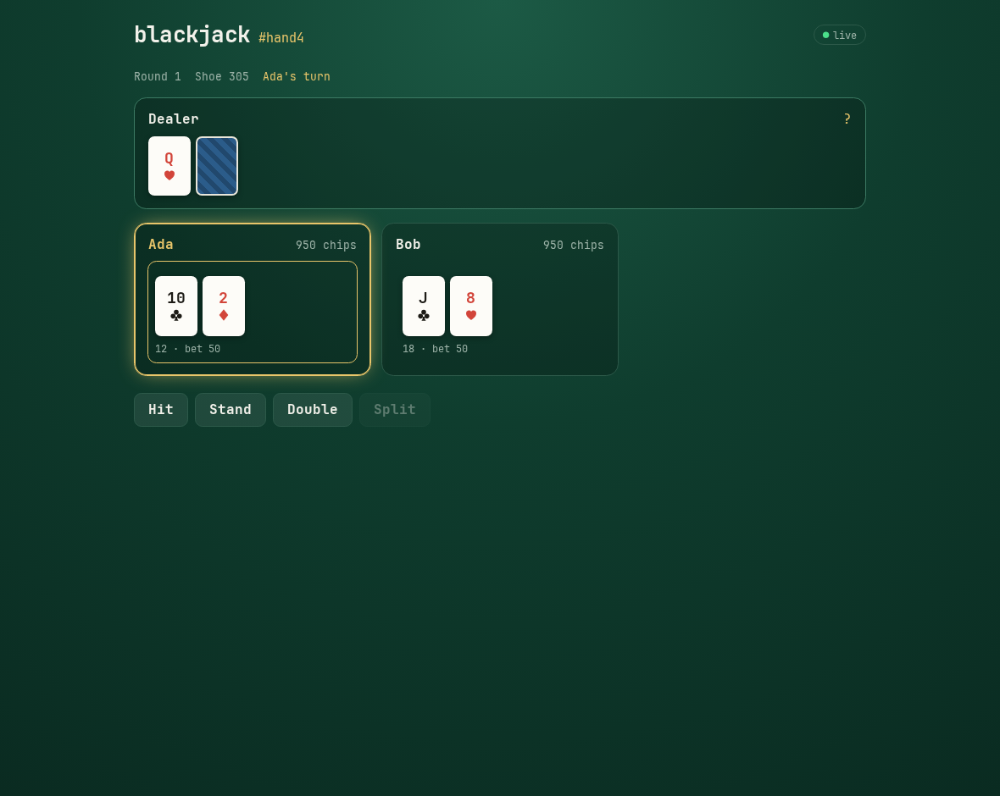
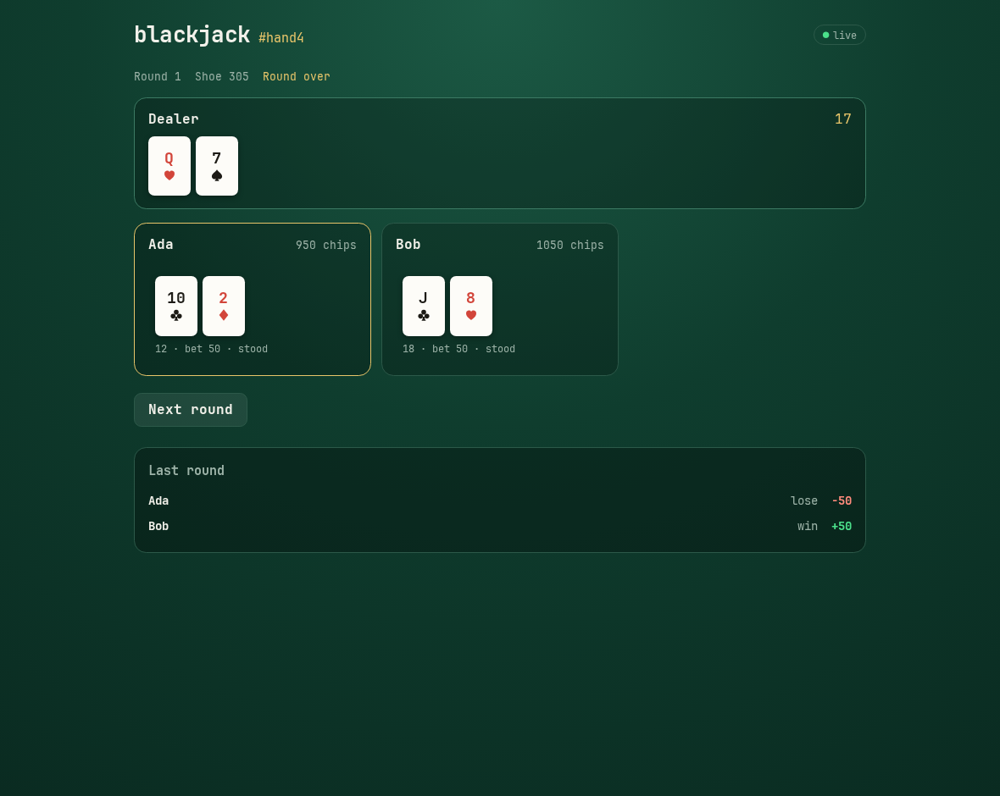

# Blackjack example

A multiplayer blackjack table: six decks, bets, insurance, splits, double down,
and per-player views so nobody sees the dealer's hole card or your legal moves.

Ported from the TypeScript engine in
[`party`](https://github.com/peculiarnewbie/party) to Gleam. The rules live in
`src/blackjack/engine.gleam` as a pure state machine; the Worker only moves
bytes and broadcasts.





## Running it

From the repository root:

```sh
pnpm install --frozen-lockfile
pnpm dev:blackjack
```

Then open two tabs (or two devices) at `/t/demo` and join with different names.
Every table is a separate Durable Object, so `/t/anything` is its own table.

## Tests

```sh
pnpm --filter @starflame/example-blackjack test
```

That runs the RPC kit's `check`, builds, runs the Gleam unit tests for the
rules, then boots the Worker in Miniflare and plays real hands over Cap'n Web.
The integration test covers seating, turn order, the hidden hole card,
settlement, chip deltas against the reported net, the next round, persistence
across a Worker restart, and table isolation.

## How it fits together

| Piece | Where | Role |
| --- | --- | --- |
| Rules | `src/blackjack/engine.gleam` | Pure: `seat`, `process`, settlement. No I/O. |
| Views | `src/blackjack/view.gleam` | One `View` per player, hole card redacted. |
| RPC | `src/blackjack/api.gleam` | `join`, `act`, `refresh`, `subscribe` |
| Codecs | `src/blackjack/codecs.gleam` | Generated from `shared.gleam` by the RPC kit. |
| Persistence | `src/blackjack/store.gleam` | The table as one JSON row in D1. |
| Sessions | `@starflame/runtime/session.ts` | `issue()` mints a token; `fromRequest()` derives the player id. |
| Table | `room.ts` | One Durable Object per table: identity, serialize, broadcast. |
| UI | `src/blackjack/client.gleam` | Lustre app. |

The state codecs are generated, not written by hand:

```toml
# gleam.toml
[starflame]
codecs = ["blackjack/shared:blackjack/codecs"]
```

`pnpm dev` regenerates them when `shared.gleam` changes; `pnpm build` and
`pnpm typecheck` check that they are current.

Two details worth knowing:

- **The dealer's hole card never leaves the server.** `views.all` builds a
  different `View` for each player, and the Durable Object sends each one only
  to that player's subscribers. `join`/`act` return only the caller's own view.
- **The caller's identity never comes from an argument.** `GET /session` issues
  a random token; the Durable Object derives a public player id from its hash and
  passes it as `auth`. No action carries a player id, so one player cannot act
  for another.
- **The table is persisted after every call.** The Durable Object keeps the
  decoded state warm, but reads it back from D1 the first time it is used after
  an eviction or deploy.

## Known limitations

- The session token is a bearer credential held in `localStorage` and sent as a
  query parameter. That is enough to stop impersonation inside the app, but it
  is not a hardened auth system: no HttpOnly cookie, expiry, or rotation. See
  `FINDINGS.md` for the framework-level gap this exposes.
- One process per table, and the whole state is rewritten on every action. That
  is fine for a table of six; it is not a high-frequency design.
- Standard, non-hibernating WebSockets: connected players keep the Durable
  Object warm. A turn-based game doesn't need hibernation, but the connection
  cost is still real.
