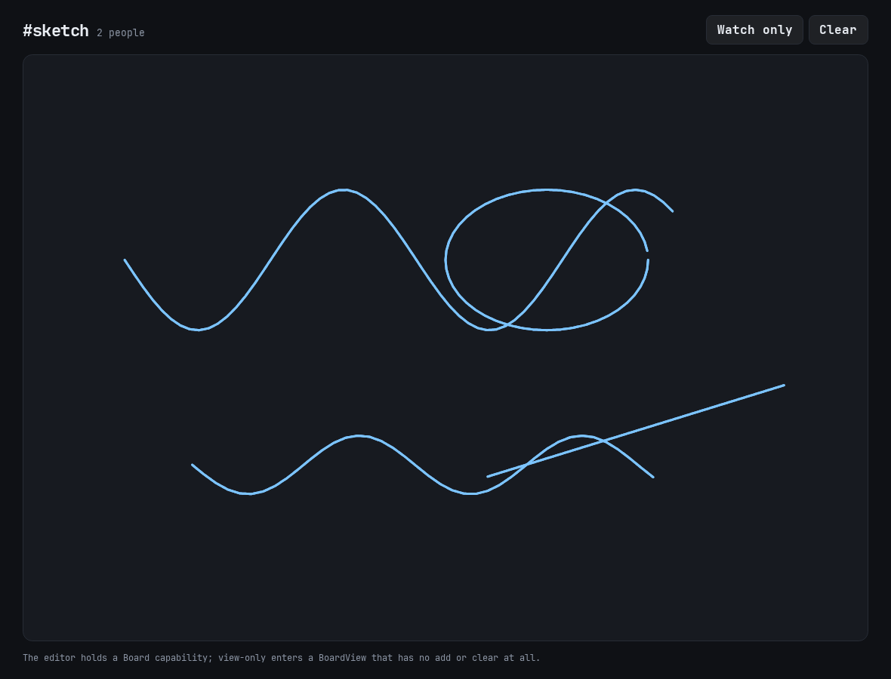

# Capability canvas

A shared whiteboard where the server hands each browser a live **capability**:
an editor gets a board they can draw on, and a viewer gets a board that has no
drawing method at all.



## Running it

```sh
pnpm install --frozen-lockfile
pnpm dev:canvas
```

Open `/b/sketch` in two tabs. Draw with a mouse or a finger; the other tab sees
the stroke immediately. **Watch only** re-enters with a read-only capability.

## How it is put together

```
root.enter(read_only) ──▶ { board: BoardApi | BoardViewApi }
```

| Capability | Methods |
| --- | --- |
| `BoardApi` (editor) | `snapshot`, `add`, `clear`, `subscribe` |
| `BoardViewApi` (viewer) | `snapshot`, `subscribe` |

Read-only is not a flag checked per call: the viewer's object simply has no
`add` or `clear`, so a call fails at the capability boundary. The tests assert
that calling `add` on a read-only board throws.

- **State:** D1, one row per stroke, points stored as JSON.
- **Transport:** Cap'n Web over WebSocket (capabilities are passed by
  reference, so this can't use HTTP RPC).
- **Client:** hand-written capability calls. The generated client cannot express
  "this method returns a stub", so `src/canvas/board_client.gleam` calls
  `client.call` directly and decodes the handle with `client.stub_decoder()`.
  The payloads still use the generated codecs.
- **Rendering:** `<canvas>` + pointer events; points are normalised to 0..1.

## Tests

```sh
pnpm --filter @starflame/example-canvas test
```

The Miniflare suite drives the capability tree with raw Cap'n Web: `enter`
returns a stub, the read-only capability refuses `add`, validation rejects empty
strokes and unknown colours, strokes round-trip through D1, `subscribe` receives
live `StrokeAdded` and `Cleared` events plus presence, rooms are isolated, and
strokes survive a restart.

## Limits

- No undo, erasing, colours, or stroke smoothing. One fixed colour and width.
- Presence counts capabilities that subscribed, not sockets.
- Edits are last-write-wins; there is no conflict handling beyond append-only
  strokes and a whole-board clear.
- The board is public: anyone with the room name can enter as an editor.
