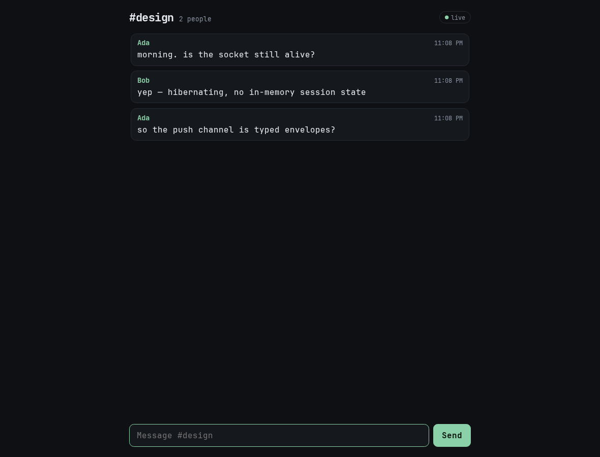

# Chat example

Rooms with history in D1 and live updates over a **hibernating** WebSocket.



## Running it

From the repository root:

```sh
pnpm install --frozen-lockfile
pnpm dev:chat
```

Open `/r/anything` in two tabs or two devices. Each room is its own Durable
Object.

## The transport

| Path | Transport |
| --- | --- |
| `send`, `history` | HTTP RPC to the room's Durable Object |
| live messages, presence | hibernating WebSocket carrying typed envelopes |

**Why not Cap'n Web on the socket?** Hibernation evicts the Durable Object,
which throws away a Cap'n Web session's in-memory state (pending calls, imports,
exports) while the socket stays open. Cap'n Web has no re-establishment
handshake, so a typed RPC session and hibernation are incompatible today.

The demo takes the honest split: calls stay on typed RPC, and the push channel
carries one-way envelopes encoded with the **same generated codecs** the RPC
layer uses:

```gleam
pub type RoomEvent {
  MessagePosted(message: Message)
  Presence(online: Int)
}
```

The client decodes each frame with `room_event_decoder`, so a malformed or
out-of-date event fails loudly instead of being silently ignored.

## Hibernation

- `ctx.acceptWebSocket(socket, [player])` and `socket.serializeAttachment({ player, name })`
- no per-connection state in the Durable Object
- presence comes from `ctx.getWebSockets()`
- the object can be evicted between messages without losing anything; a
  reconnect only needs the room and name

## Tests

```sh
pnpm --filter @starflame/example-chat test
```

The Miniflare suite covers origin and session rejection, message validation,
presence counts on connect/disconnect, typed events reaching the other socket,
history order, room isolation, and recovery after a Worker restart.

## Limits

- Messages live in D1, not DO SQLite: the runtime has no DO-storage bindings
  yet. One row set per room, no pagination beyond the last 200 messages.
- Names are chosen by the client and not unique; the session id is the real
  identity.
- No editing, deleting, typing indicators, or read receipts.
- Local tests can't reproduce a hibernation eviction; see `FINDINGS.md` for what
  they prove instead.
