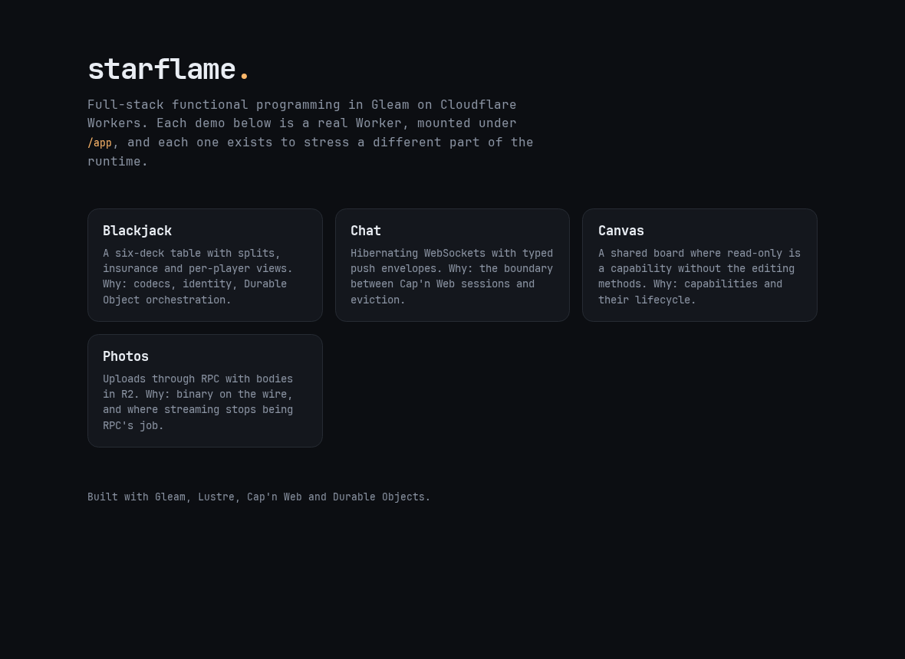

# Landing page

Served at [starflame.peculiarnewbie.com](https://starflame.peculiarnewbie.com).
One Worker with inline HTML; each demo has its own, more specific route.



## Mounts

| Path | Worker | Route |
| --- | --- | --- |
| `/` | `starflame-landing` | `starflame.peculiarnewbie.com/*` |
| `/app/blackjack/` | `starflame-blackjack` | `.../app/blackjack/*` |
| `/app/chat/` | `starflame-chat` | `.../app/chat/*` |
| `/app/canvas/` | `starflame-canvas` | `.../app/canvas/*` |
| `/app/photos/` | `starflame-photos` | `.../app/photos/*` |

Routes are attached with `triggers.fetch({ pattern, zone })` in each app's
`cloudflare.config.ts`. The landing route is the least specific, so the app
routes win.

## Deploying

```sh
pnpm --filter @starflame/example-landing deploy
```

The hostname needs a proxied DNS record (`starflame` in `peculiarnewbie.com`).
The record's value doesn't matter for the landing or the app routes — Workers
intercept the request — but it must exist and be proxied.
