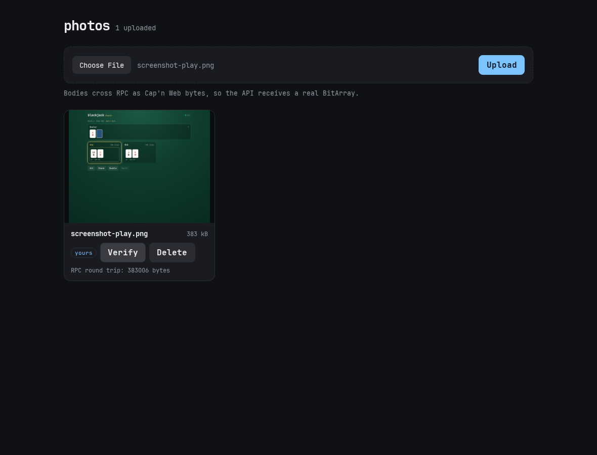

# Photos example

Upload an image through RPC, keep the bytes in R2, the metadata in D1, and
serve the picture straight from the bucket.



## Running it

From the repository root:

```sh
pnpm install --frozen-lockfile
pnpm dev:photos
```

Then open `http://localhost:5173/` and upload a PNG, JPEG, WebP or GIF under
2 MB.

## What it exercises

- **Binary over RPC.** `upload(name, content_type, body)` takes a `BitArray`.
  The wire layer sends it as Cap'n Web bytes (a `Uint8Array`), not base64.
- **R2 bindings.** `starflame/r2` wraps put/get/delete.
- **HTTP RPC.** There's no Durable Object: the Worker calls
  `newWorkersRpcResponse(request, newApi(...))` directly, and the client uses
  `connect_http`, one request per call.
- **Sessions.** `GET /session` issues a token; the owner id is a hash of it, so
  the UI can show "yours" without exposing the credential.

| File | Contents |
| --- | --- |
| `src/photos/shared.gleam` | `Photo`, `PhotoError`, limits and allowed types |
| `src/photos/api.gleam` | Upload, list, read back, delete; D1 + R2 |
| `src/photos/client.gleam` | Lustre gallery |
| `worker.ts` | Session, RPC, and `/photos/:id` from R2 |
| `src/photos/codecs.gleam` | Generated by `pnpm codecs` |

## Tests

```sh
pnpm --filter @starflame/example-photos test
```

The Miniflare suite covers validation (empty, oversize, wrong type, blank
name), metadata, a **byte-for-byte RPC round trip** of a payload containing
non-UTF-8 bytes, serving from R2 with the stored content type, ownership (one
session can't delete another's), deletion removing the R2 object, and
persistence across a Worker restart.

## Limits

- 2 MB per file, images only, no user accounts beyond a session token.
- Images are public: anyone with `/photos/<id>` can fetch them.
- No multipart uploads, range requests or presigned URLs. If you need those,
  upload directly to R2 and keep only the key in D1.
- The gallery lists every upload; there are no albums or pagination.
